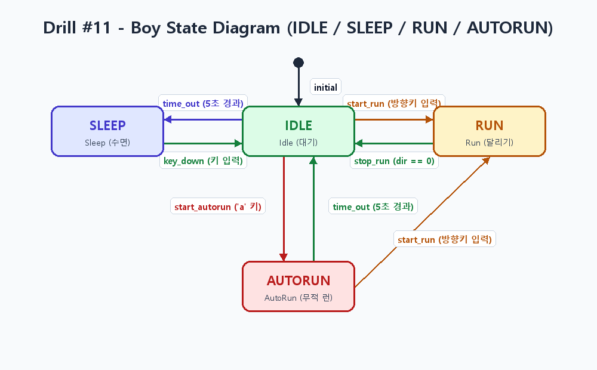
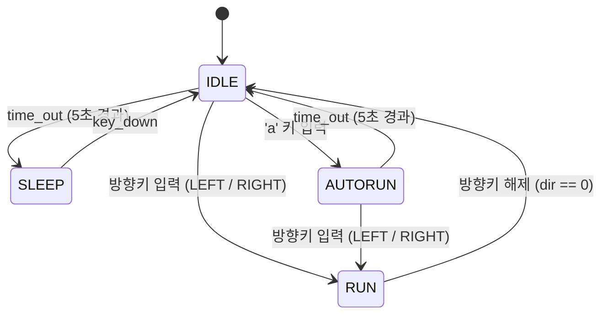

# PRD: Drill #11 - 소년 자동 무적 런 (AutoRun) 상태 추가

## 1. 프로젝트 개요
- **과제명**: Drill #11. 소년 - 자동 무적 런(AutoRun) 상태 추가 (5점)
- **목표**: 소년(`Boy`) 캐릭터의 유한 상태 머신(FSM)에 **자동 무적 런(`AutoRun` / `AUTORUN`)** 상태를 추가하여, 키 조작 없이도 고속·확대 상태로 화면 좌우를 왕복 이동하는 기능을 구현하고 상태 다이어그램을 작성한다.

---

## 2. 핵심 요구사항 (Functional Requirements)

### FR-1. AutoRun 상태 진입
- **조건**: `IDLE` 상태에서 사용자가 `'a'` 키(`SDLK_a`)를 누를 때(`SDL_KEYDOWN`).
- **동작**:
  - `AutoRun` 상태로 전이한다.
  - 진입 시점의 시간(`autorun_start_time = get_time()`)을 기록한다.
  - 이동 방향은 소년이 현재 바라보고 있는 방향(`face_dir`)으로 설정하여 자동 이동을 시작한다.

### FR-2. AutoRun 상태의 행동 및 표현
- **자동 이동 및 속도 증가**:
  - 키 조작 없이 현재 이동 방향으로 계속 좌우 이동한다.
  - 일반 `RUN` 상태(속도 `5`)보다 빠른 속도(예: `10` ~ `15`)로 이동한다.
- **크기 확대 및 위치 보정**:
  - 소년의 렌더링 크기를 기본(`100x100`)보다 확대(예: `200x200`)하여 그린다.
  - 크기가 커짐에 따라 발 위치가 잔디(`Grass`) 위에 자연스럽게 맞도록 `y` 좌표 오프셋(예: `self.y + 30`)을 보정하여 렌더링한다.
- **화면 좌우측 끝 자동 방향 전환**:
  - 화면 왼쪽 끝(예: `x <= 50` 또는 `25`)에 도달하면 이동 방향과 바라보는 방향(`face_dir`)을 오른쪽(`1`)으로 전환한다.
  - 화면 오른쪽 끝(예: `x >= 800 - 50` 또는 `800 - 25`)에 도달하면 이동 방향과 바라보는 방향(`face_dir`)을 왼쪽(`-1`)으로 전환한다.

### FR-3. 시간 경과에 따른 IDLE 복귀
- **조건**: `AutoRun` 상태에 진입한 후 **5.0초 이상** 경과했을 때 (`get_time() - autorun_start_time > 5.0`).
- **동작**:
  - `IDLE` 상태로 자동 복귀(`time_out` 전이)한다.
  - 소년의 크기와 이동 속도는 원래대로 돌아온다.

### FR-4. 방향키 입력에 따른 Run 상태 전환
- **조건**: `AutoRun` 상태에서 좌/우 방향키(`SDLK_LEFT`, `SDLK_RIGHT`)가 눌렸을 때(`SDL_KEYDOWN`).
- **동작**:
  - 자동 무적 런(`AutoRun`)이 즉시 취소되고 일반 `RUN` 상태로 전이한다.
  - 눌린 방향키의 방향(`self.dir`)으로 이동하며, 소년의 크기와 속도는 일반 `RUN` 상태(`100x100`, 속도 `5`)로 돌아온다.

---

## 3. 아키텍처 및 구현 명세 (Technical Specifications)

> **참고**: 현재 [`boy.py`](file:///c:/DRILL11/boy.py)는 `transitions` 라이브러리의 `Machine`을 사용하고 있으며, 과제 지시사항에는 *"반드시 AutoRun 상태 클래스를 추가해서 구현해야 함"*이라는 조건이 명시되어 있습니다. 수업 진행 방식에 맞춰 아래 두 가지 구조 중 하나로 구현하거나 통합할 수 있습니다.

### 3.1. 상태 정의
| 상태명 | 설명 | 크기 (`w, h`) | 이동 속도 |
| :--- | :--- | :---: | :---: |
| `IDLE` (`Idle`) | 정지 대기 상태 (5초 경과 시 `SLEEP` 전이) | `100 x 100` | `0` |
| `SLEEP` (`Sleep`) | 수면 상태 (아무 키 입력 시 `IDLE` 전이) | `100 x 100` | `0` |
| `RUN` (`Run`) | 방향키 조작을 통한 일반 달리기 상태 | `100 x 100` | `5` |
| `AUTORUN` (`AutoRun`) | `'a'` 키로 진입하는 자동 무적 런 상태 | `200 x 200` | `10 ~ 15` |

### 3.2. 상태 전이 표 (State Transition Table)
| 현재 상태 (Source) | 이벤트 / 조건 (Trigger) | 다음 상태 (Dest) | 비고 |
| :--- | :--- | :--- | :--- |
| `IDLE` | `time_out` (5초 경과) | `SLEEP` | 대기 시간 초과 |
| `SLEEP` | `key_down` (키 입력) | `IDLE` | 수면 해제 |
| `IDLE` | 방향키 입력 (`LEFT` / `RIGHT` down) | `RUN` | 일반 달리기 시작 |
| `RUN` | 방향키 해제 (`dir == 0`) | `IDLE` | 달리기 멈춤 |
| **`IDLE`** | **`'a'` 키 입력 (`SDLK_a` down)** | **`AUTORUN`** | **자동 무적 런 시작** |
| **`AUTORUN`** | **`time_out` (5초 경과)** | **`IDLE`** | **자동 무적 런 종료** |
| **`AUTORUN`** | **방향키 입력 (`LEFT` / `RIGHT` down)** | **`RUN`** | **무적 런 취소 후 수동 런 전환** |

### 3.3. 상태 다이어그램 (State Diagram)

---

## 4. 제출물 및 채점 기준 체크리스트 (Grading Rubric - 총 5점)

- [x] **1. `'a'` 키 입력 시 AutoRun 상태 이동 (1점)**
  - `IDLE` 상태에서 `'a'` 키를 누르면 즉시 `AutoRun` 상태로 전환되는가?
- [x] **2. 5초 이상 경과 시 Idle 상태 복귀 (1점)**
  - `AutoRun` 진입 후 5초가 지나면 자동으로 `IDLE` 상태로 돌아가는가?
- [x] **3. AutoRun 모드에서 속도 증가 및 크기 확대 (1점)**
  - 일반 `RUN` 상태보다 이동 속도가 빠르고 캐릭터 크기가 확대되어 렌더링되는가?
  - 도중에 방향키를 누르면 즉시 원래 크기/속도의 `RUN` 상태로 전환되는가?
- [x] **4. 화면 좌우측 끝에서 자동 방향 전환 (1점)**
  - 화면 좌우 경계를 벗어나지 않고 양 끝에서 반사되듯 방향(`face_dir`)을 바꾸며 계속 달리는가?
- [x] **5. 상태 다이어그램 이미지 포함 제출 (1점)**
  - 상태 다이어그램을 그려서 이미지 파일(`.png` 등) 형태로 저장소에 함께 커밋/제출하였는가?
